# Fitness

A weightlifting companion for Android. Build a training plan once, then let the app guide you through
every set, remember how each exercise felt, and nudge the weight up when you're ready.

<p align="center">
  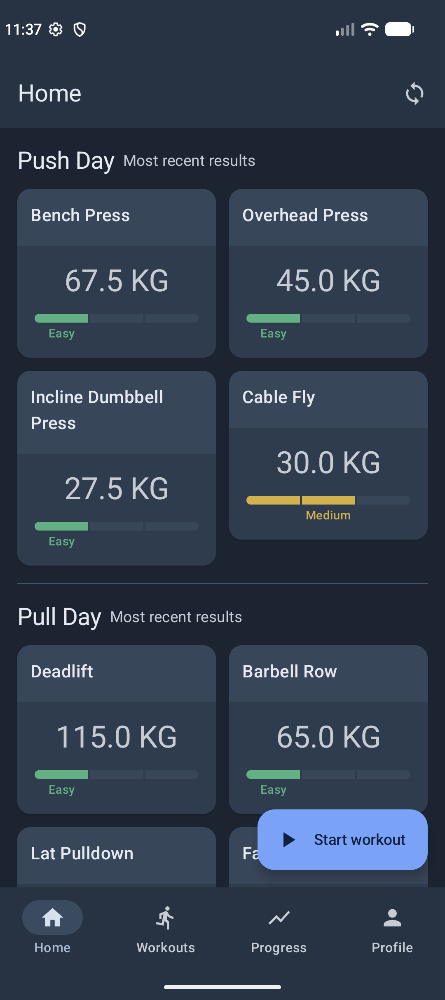
  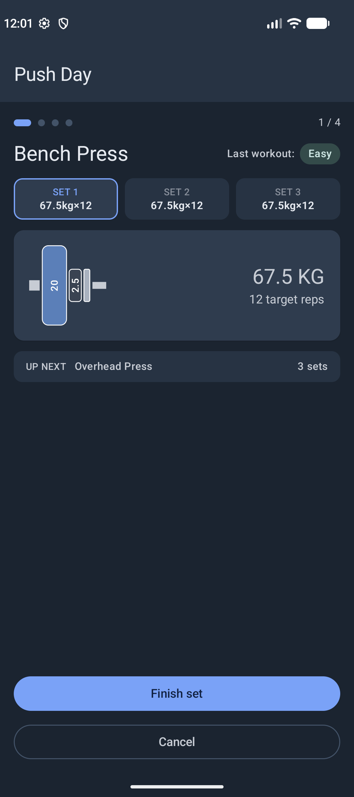
  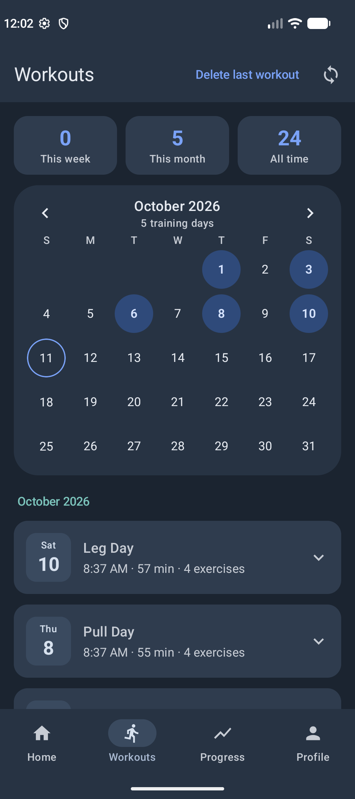
  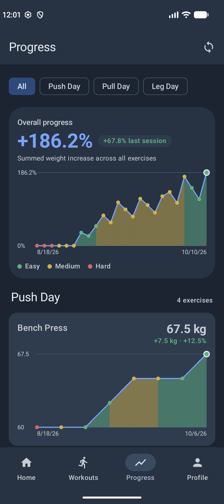
</p>

## Features

- **Training plans** made of workouts, each with an ordered list of exercises (free weights or cable).
- **Guided workout sessions**: warm-up, then each working set in turn, with a visual barbell plate
  breakdown (free weights) or weight-stack pin (cable) and a rest timer between sets.
- **Progressive overload**: you rate every exercise Easy / Medium / Hard. The rating picks next time's
  rep target, and two Easy ratings in a row prompt you to raise the weight.
- **Workout history** with a training calendar and per-exercise results for every session.
- **Progress charts** of weight over time per exercise and for the whole plan, colored by how it felt.
- **Multiple plans**: switch, edit, export, import and delete them.
- **Weight stacks**: define your gym's cable machines once and the app suggests their real next level.
- **Google Drive sync** (optional) between devices, stored in the app's private Drive folder.
- **Garmin watch app** (optional, Forerunner 745): follow the workout from your wrist and record your heart rate,
  with a heart rate graph, set marks and recovery between sets in the Workouts history. The workout also syncs to
  Garmin Connect as a strength activity. See [Garmin watch app](#garmin-watch-app).

## Using the app

The bottom bar has four tabs: **Home**, **Workouts**, **Progress** and **Profile**. The sync button at
the top right is available on every tab.

### 1. Set up your first plan

On a fresh install the app asks you to create a plan:

1. Name the plan and add the workouts it consists of (for example *Push*, *Pull*, *Legs*).
2. For each workout, add exercises. Per exercise you choose:
   - the **equipment type**: free weights or cable,
   - **sets and reps** (the rep scheme is 8-10-12, see [Rep targets](#rep-targets)),
   - the **starting weight** in kg,
   - for cable exercises, the **weight stack** of the machine,
   - the **rest time** between sets in seconds.
3. Tap **Finish setup**.

You can create more plans later from the Profile tab.

### 2. Home: your plan at a glance


Home shows the active plan: every workout with its exercises as cards. Each card shows the exercise's
**current weight** and a three-segment bar with how the **last session at that weight** felt (green
Easy, yellow Medium, red Hard). "Nothing on record yet" means the exercise hasn't been performed since
its weight last changed.

The workouts are listed starting with the one that's **up next**. The app rotates through your plan on
its own, based on the sessions you've completed.

Tap **Start workout** to begin the next workout.

<br clear="right" />

### 3. Training: the guided session

<p>
  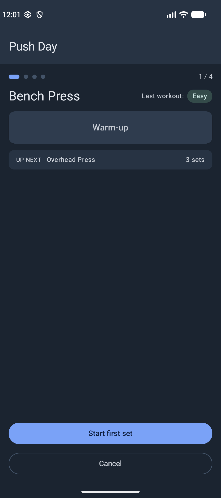
  
  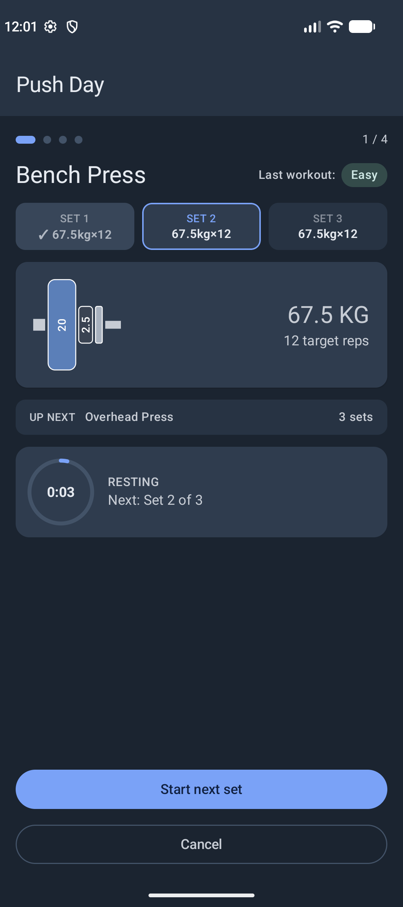
  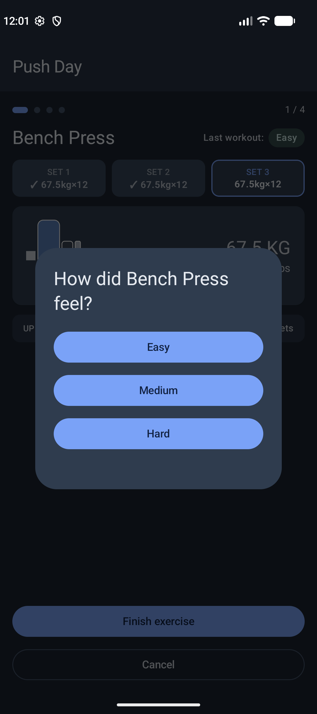
  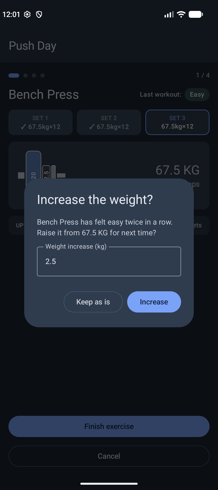
</p>

The session walks through the workout's exercises one at a time, in order. The dots at the top show how
far through the workout you are.

1. **Warm-up.** Each exercise starts with a warm-up. A badge shows how the exercise felt last time.
   Tap **Start first set** when you're ready.
2. **Working sets.** The set pills show every set's target weight and reps: finished sets get a check
   mark, the current one is highlighted. For **free weights** the card draws the plates to load on each
   side of the bar (largest closest to the collar). For **cable** exercises it draws the weight stack
   with the pin at your current level. Tap **Finish set** when you're done.
3. **Rest.** Between sets a countdown ring runs towards your rest goal. You get a notification when it's
   time for the next set (the app asks for notification permission the first time). Tap **Start next
   set** to continue early or late, the timer doesn't force you.
4. **Rate it.** After the last set of an exercise, rate how it felt: **Easy**, **Medium** or **Hard**.
   You can't skip this, the rating drives everything else.
5. **Weight increase.** If an exercise felt Easy twice in a row, the app offers to raise the weight. The
   increase is prefilled (the exercise's increment, or the next level of its weight stack for cable
   exercises) and you can edit it, or choose **Keep as is**.
6. **Finish.** After the last exercise the whole session is saved with today's date and shows up in
   Workouts and Progress.

**Cancel** leaves the session. Nothing from an unfinished workout is saved, not even the ratings.

#### Rep targets

Every exercise has the rep scheme **8-10-12**. The target for all sets of a session depends on how the
last session felt: no history or Hard means 8 reps, Medium means 10, Easy means 12. Once you hit 12
easy reps twice, you add weight and start over at 8.

### 4. Workouts: your history


Workouts is the log of everything you've completed under the active plan:

- **Three tiles** with training days this week, this month, and sessions overall.
- A **calendar** marking every training day. Use the arrows to change month, tap a marked day to show
  only that day's sessions, and tap it again to clear the filter.
- **Session cards**, grouped by month, newest first. Each shows the workout, time, duration and number
  of exercises. Tap a card to expand it and see every exercise's weight and effort rating.

Logged the wrong workout? **Delete last workout** in the top bar removes the most recent session. Only
the latest one can be deleted, because later sessions build on earlier ratings and weights.

<br clear="right" />

<p>
  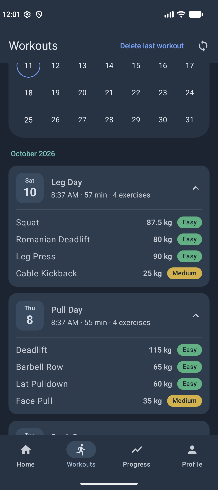
</p>

### 5. Progress: are you getting stronger?


Progress charts your weights over time:

- The **Overall progress** card sums, for each session, every exercise's percentage increase compared to
  its own starting weight. The big number is the current total, the pill shows the change in the last
  session.
- Below it, every exercise has its own **weight-over-time chart** with the current weight and the change
  since the first session.
- The **chips at the top** (All, then one per workout) filter the charts to a single workout.
- Chart colors tell you how it felt: the area under each segment and each dot are green for Easy, yellow
  for Medium and red for Hard.

An exercise needs at least two logged sessions before its chart appears.

<br clear="right" />

### 6. Profile: plans, weight stacks and sync

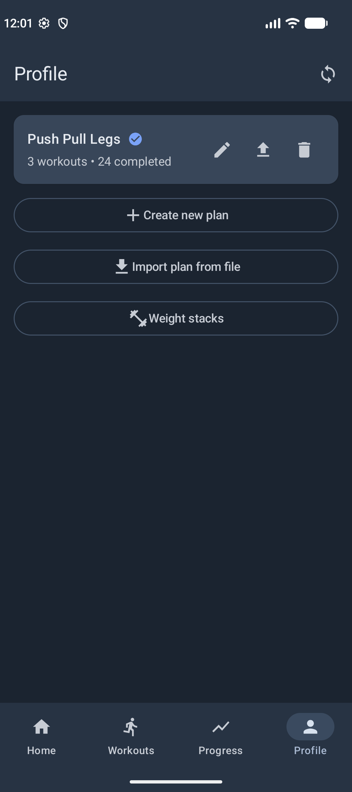

Profile manages your plans. Each card shows the plan name, how many workouts it has and how many sessions
you've completed with it. The checkmark marks the **active plan**; tap any other plan to switch to it.
The icons on the right of each card are:

- **Edit** (pencil): open the [plan editor](#editing-a-plan),
- **Export** (arrow up): save the plan as a `.json` file,
- **Delete** (bin): remove the plan together with its workouts and history, after a confirmation.

Below the plans:

- **Create new plan** starts the same setup flow as on first launch.
- **Import plan from file** loads a plan exported earlier, to restore it or share it with someone else.
- **Weight stacks** opens the weight stack manager, see below.

<br clear="right" />

#### Editing a plan

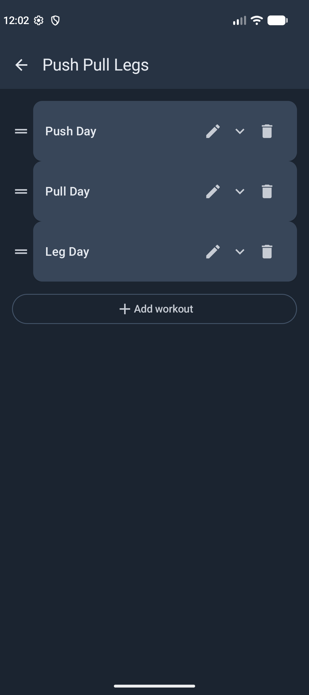

The plan editor lists the plan's workouts. Drag the handle on the left to **reorder** them, which also
changes the rotation order. Use the pencil to rename a workout, the chevron to expand it and manage its
exercises (add, reorder, delete), and **Add workout** to append a new one.

<br clear="right" />

#### Weight stacks

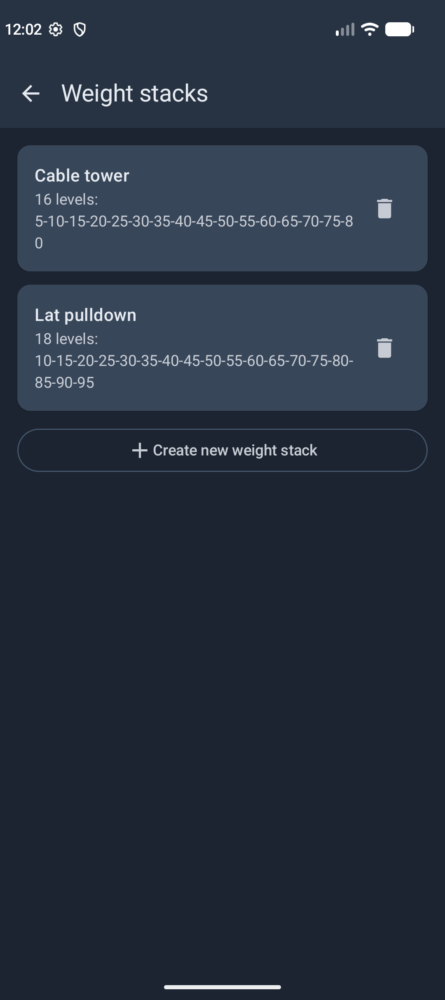

Cable machines don't have evenly spaced weights. A **weight stack** is a named list of a machine's
levels (for example `5, 10, 15, 20`). Assign one to a cable exercise and the weight-increase prompt
suggests the machine's real next level, and the session screen draws the stack with the pin at the
right plate. Tap a stack to edit it, use the bin to delete it (exercises using it fall back to free
entry), or **Create new weight stack** to add one. You can also create a stack on the fly when adding
an exercise.

<br clear="right" />

### Sync across devices

The app signs in with your Google account when it starts and syncs your plans, history and weight
stacks through Google Drive. It only ever uses the app's own hidden Drive folder, never your regular
Drive files. Tap the **sync** button in the top bar to sync on demand, a dot on the icon means you have
changes that haven't been synced yet. When two devices changed the same item, the most recent change
wins.

### Garmin watch app

The optional Connect IQ app in [`garmin/`](garmin/README.md) mirrors the running workout on a Forerunner 745. You
finish sets, rate exercises and answer the weight offer from the watch, and it records your heart rate once a
second. The phone saves the readings with the workout, works out the average and highest heart rate of the session
and of each exercise, and shows them in the Workouts history: a heart rate graph with a mark where each working set
began and ended, and the fall in the minute after a set. The watch also records the workout as a strength activity
(a lap per set) that syncs to Garmin Connect. Setup and build steps are in the [watch app README](garmin/README.md).

## Tech stack

- Kotlin, Jetpack Compose, Material 3
- [Room](https://developer.android.com/training/data-storage/room) for local persistence
- Jetpack DataStore (Preferences) for lightweight app state (e.g. the active plan)
- Jetpack Navigation Compose
- Google Credential Manager + Drive `appDataFolder` for sync
- Garmin Connect IQ Mobile SDK for the watch connection; the watch app is Monkey C
- No DI framework, dependencies are plain lazily-built singletons exposed from `FitnessApplication`

## Project structure

```
app/src/main/java/com/akreutz/fitness/
├── data/
│   ├── model/        # Room entities and value types (TrainingPlan, Workout, Exercise, ...)
│   ├── db/           # Room database and DAOs
│   ├── prefs/        # DataStore-backed preferences
│   ├── export/       # Plan export/import (JSON)
│   ├── sync/         # Google Drive sync: auth, snapshot merge, change tracking
│   ├── watch/        # Garmin watch connection, message format, heart rate receiving
│   └── repository/   # TrainingPlanRepository, the single point the UI talks to for data
├── ui/
│   ├── home/         # Home tab: active plan, onboarding / plan creation
│   ├── workouts/     # Workouts tab: history, calendar, heart rate graph
│   ├── progress/     # Progress tab: charts
│   ├── profile/      # Profile tab: plan management, plan editor, weight stacks
│   ├── session/      # Guided workout screen, rest timer
│   ├── common/       # Shared composables (dialogs, draggable list, ...)
│   └── theme/        # Colors, effort colors, typography, theme
├── FitnessApplication.kt
└── MainActivity.kt   # Navigation graph and bottom-nav scaffold

garmin/               # Connect IQ watch app (Monkey C), see garmin/README.md
```

## Building

Open the project in Android Studio, or build from the command line:

```
./gradlew.bat assembleDebug     # debug build, installs alongside release
./gradlew.bat assembleRelease   # signed release APK (requires signing config, see below)
./gradlew.bat bundleRelease     # signed release AAB, for Play Store upload
```

The debug build type applies `.debug` as an `applicationIdSuffix` and shows as "Fitness Debug" on the
home screen, so it can be installed side by side with a release build.

### Release signing

Release builds are signed using credentials read from `local.properties` (which is gitignored and never
committed). Add the following keys to your `local.properties`:

```properties
release.storeFile=C:\\path\\to\\your\\release.keystore
release.storePassword=...
release.keyAlias=...
release.keyPassword=...
```

If these keys are absent, `assembleRelease`/`bundleRelease` will still build an unsigned artifact.

To generate a new keystore:

```
keytool -genkeypair -v -keystore release.keystore -alias <alias> -keyalg RSA -keysize 2048 -validity 10000
```

Release builds have R8 minification and resource shrinking enabled (`app/proguard-rules.pro` holds any
project-specific keep rules).

### Debug signing

By default, debug builds are signed with the machine's `~/.android/debug.keystore`. To use a shared
debug keystore instead (for example one kept on a synced drive, so every machine produces the same
signing certificate), add this to `local.properties`:

```properties
debug.storeFile=G:/path/to/debug.keystore
```

The password and alias default to the standard Android debug values (`android` / `androiddebugkey`);
override them with `debug.storePassword`, `debug.keyAlias` and `debug.keyPassword` if needed. In
`.properties` files a single backslash is an escape character, so write paths with forward slashes or
doubled backslashes.

## Requirements

- Android Studio (current stable)
- Min SDK 24, target/compile SDK 37
- JDK 11 (via `compileOptions` / core library desugaring)
